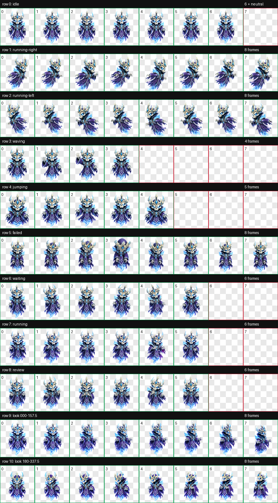

# Frostlich

Frostlich is an original icy archlich custom pet for the ChatGPT desktop app and compatible Codex clients. He has a skull face, crown-like bone horns, tattered violet robes, and a cold blue spectral glow.



## Install

### Windows

Run the PowerShell installer from this folder:

```powershell
.\install.ps1
```

### macOS or Linux

Run the shell installer from this folder:

```sh
chmod +x install.sh
./install.sh
```

### Manual installation

Copy `pet.json` and `spritesheet.webp` into:

```text
~/.codex/pets/frostlich/
```

Then open **Settings > Pets**, select **Refresh**, and choose **Frostlich**.

## Format

- Sprite format: WebP with transparency
- Atlas size: 1536 x 2288
- Grid: 8 columns x 11 rows
- Sprite version: 2

## Known issue

The horizontal look reactions are reversed: Frostlich may look left when asked to look right, and vice versa. The standard idle, movement, waving, jumping, waiting, running, failure, and review animations are unaffected.

## License

No license has been selected for this repository. Add the license you want before inviting reuse or redistribution.
